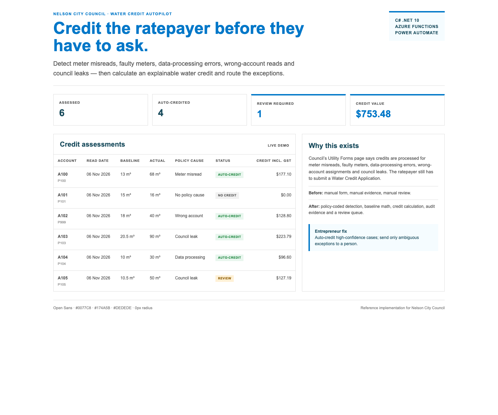

# Nelson water credit autopilot

C# .NET 10 reference implementation for Nelson City Council’s water-credit
policy.

 It turns a manual “Water Credit Application” into an explainable
assessment pipeline for meter misreads, faulty meters, data-processing errors,
wrong-account reads and council leaks.

## The pain point

Nelson’s published Utility Forms page says credits for excess water are always
processed for:

- misreading of the meter or a faulty meter
- errors in data processing
- the meter being assigned to the wrong account
- a leak on a council fitting

The ratepayer still has to notice the charge and submit a Water Credit
Application. This repository encodes the policy, computes the credit and routes
only ambiguous cases to a human reviewer.

## Stack

- C# .NET 10 minimal API and dashboard
- xUnit
- T-SQL schema and candidate view
- Microsoft Fabric Lakehouse SQL
- Power Automate flow definition
- Power BI TMDL semantic model
- GitHub Actions

## Run

```bash
dotnet build NelsonWaterCredit.slnx
dotnet test NelsonWaterCredit.slnx
dotnet run --project src/NelsonWaterCredit
# http://localhost:5000
```

API:

```bash
curl http://localhost:5000/api/assessments
curl http://localhost:5000/api/summary
```

## Policy formula

- Baseline = median of up to six prior measured reads.
- Policy cause = wrong account, council leak, data-processing error, faulty
  meter, or a read at least 4× / at most 0.1× the baseline.
- Chargeable usage = 0 for wrong-account/data-processing causes, otherwise the
  baseline.
- Excess = max(0, actual − chargeable).
- Credit = excess × volumetric rate; GST = 15%; total = credit + GST.
- Confidence = 0.95 for six reads, 0.85 for three, 0.65 below the minimum.
- Auto-credit at confidence ≥ 0.85; otherwise review.

The volumetric rate is a policy parameter, not a claim about the current
published rate.

## Verification

- 30 xUnit tests.
- Dashboard and JSON API.
- T-SQL and Fabric Lakehouse schemas.
- Power Automate and Power BI contracts.

## Scope

This is a reference implementation. It does not claim live council database,
rates, Power Automate or Fabric access.
